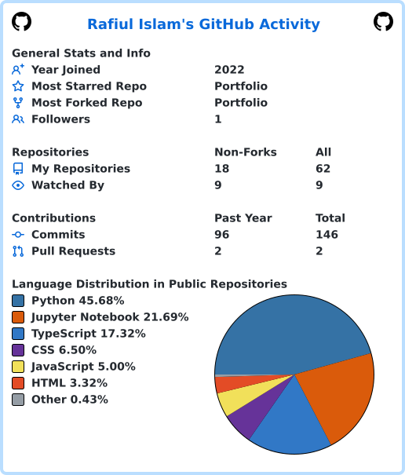

## Hi there, I'm MD Rafiul Islam 👋  
### 💻 Researcher | Machine Learning & AI Engineer (Computer Vision + Computational Healthcare)

I’m a computer science researcher and applied ML engineer working at the intersection of **computational healthcare** and **trustworthy AI**.My core research treats **voice analysis as a vision-driven learning problem**—transforming Bengali speech into **time–frequency representations** (log-mel / mel spectrograms) and learning with **CNNs, Vision Transformers (ViTs), and hybrid CNN–Transformer models** to support **scalable, clinically meaningful, and interpretable** psychological stability assessment.

Alongside research, I build **production-grade, real-time computer vision systems** for industrial safety, compliance, inspection, and anomaly detection—designed with a **validation-first** mindset (temporal reasoning, state machines, evidence logging, and robust deployment).

---

### 🏆 Highlights:

- ## 🔍 **Research Interests**:
  - Mental health diagnostics through voice data.
  - Signal processing and spectrogram-based feature extraction.
  - Enhancing diagnostic accuracy in healthcare through advanced transfer learning methods.
  - Deploy Deep learning architectures like CNNs, ViT's, GRU, Multi-Path based network.
  - Improving transparency in AI diagnostics using XAI techniques.
  - Innovating hybrid quantum-classical architectures for solving complex healthcare challenges.
  - **Reliable, real-time industrial AI** (safety, compliance, inspection) using detection, tracking, OCR, pose-based reasoning, and temporal logic.
  - **Robustness-first AI engineering**: validation-driven pipelines, edge constraints, evidence generation, and API-integrated deployments.

- ## 📚 **Research Papers**:
  - [Mental Health Diagnosis From Voice Data Using Convolutional Neural Networks and Vision Transformers](https://doi.org/10.1016/j.jvoice.2024.10.010)
 
  - [Using Computer Vision for Skin Disease Diagnosis in Bangladesh Enhancing Interpretability and Transparency in Deep Learning Models for Skin Cancer Classification](https://doi.org/10.48550/arXiv.2501.18161)

---

### 🧠 Research Projects:

1. **Mental Health Diagnosis Using CNNs and Vision Transformers**  
   - Developed a hybrid ViT-CNN model to classify psychological stability using voice spectrograms.
   - Achieved 91% accuracy by leveraging CNNs for local patterns and Vision Transformers for long-range dependencies.
   - Published in the **Journal of Voice (Q1)**.

2. **Transfer Learning for Mental Stability Classification**  
   - Proposed a transfer learning pipeline with DenseNet121 achieving 94% accuracy and 99% AUC.
   - Addressed data imbalance with SpecAugment and Gaussian noise.

3. **Bengali Vocal Spectrum Dataset**  
   - Created the first open-source Bengali voice dataset for psychological stability analysis.
   - Extracted features with log-mel spectrograms for mental health research.
   - 85 recordings (4.65 hours) with a 48,000 Hz sampling rate, 128 mel bands, and 2048 window size.

4. **Skin Cancer Diagnosis Using Computer Vision**  
   - Implemented a deep learning-based diagnostic system for skin cancer classification.
   - Enhanced model explainability with saliency maps for improved transparency.

5. **Hybrid Deep Models for Mental Health Detection with XAI Techniques** 
   - Integrated DenseNet, ViTs, and GRU to detect mental instability.
   - Employed Explainable AI (XAI) to interpret decision-making processes.
     
6. **Self-Supervised Learning with Vision Transformer (ViT) for Noisy Real-World Data**  
   - Leveraged self-supervised learning and ensemble techniques to classify mental stability from unprocessed, noisy data.
     
7. **Hybrid Quantum-Classical Neural Network (H-QCNN) for Voice Analysis**  
   - Designing a hybrid model combining quantum circuits for feature extraction with classical CNN layers for classification.
   - Will apply to voice spectrograms to enhance classification accuracy.

---

## 🏭 Industrial / Production AI Projects (Real-time Computer Vision)

> End-to-end systems: detection → tracking → OCR/pose/depth → temporal logic → validation → evidence → API integration → edge deployment.

1. **Track My Container — Multi-Stage Container Identification (Edge AI)**  
   - Fisheye undistortion + oriented bounding box detection + crop pairing logic.
   - OCR with PaddleOCR + ISO 6346 check-digit validation + prefix-correction heuristics.
   - Real-time serial/API integration on edge devices for robust container ID capture.

2. **Bangla ANPR (Automatic Number Plate Recognition) — Real-Time Pipeline**
   - YOLO (OBB) plate detection + tracking (ByteTrack/BoxMOT) + ROI gating.
   - Bengali OCR (PaddleOCR) with language-specific dictionaries + format validation + confidence voting.
   - Event deduplication, rate limiting, and multi-camera entry/exit logic.

3. **Unilever Staircase Safety — Pose-Based Compliance**  
   - YOLO person detection + MediaPipe Pose reasoning for handrail usage & phone-use detection.
   - Temporal state stabilization, evidence capture, and API posting via decoupled watcher services.

4. **Factory Safety & Compliance Platform (Intrusion, PPE, Safety Violations, Throwing Detection)**  
   - Multi-camera detection/tracking + ROI masks + hysteresis/persistence logic.
   - Evidence-backed alerts with SQLite-based logging per camera and cooldown control.

5. **AI SOP Checker (Real-time SOP Compliance Auditing System)**  
   - Multi-process RTSP pipeline with ROI logic, snapshot evidence generation, and API reporting.
   - Multiple SOP modules (barcode scan, weighing behavior, moisture check, layer-by-layer check) with persistent state files.

6. **Smart Space Monitoring — Retail Intelligence CV Platform**  
   - Footfall analytics, customer–bike interaction, employee vs customer desk classification (zone hysteresis + sessions).
   - Identity persistence + CRM capture (face/upper/full-body crops) and KPI analytics (service delay, time-to-interaction).

7. **Counterfeit Detection (Hybrid CV + DL)**  
   - Watermark authenticity checks using classical CV + OCR verification (CLAHE + threshold search).
   - YOLO-based counterfeit classifier deployed via Streamlit with logging and batch inference support.

8. **Crowd / Mob Detection (Depth-Aware Analytics)**  
   - YOLO multi-class detection + DeepSORT tracking + monocular depth estimation (Depth-Anything-V2).
   - Spatial clustering + heatmap smoothing + escalation logic (weapon-aware) for public-safety scenarios.

---

## Agentic AI Projects

I build LLM applications with evaluation, traceable decisions, and human review where the workflow calls for it.

- **AgentOps** helps teams observe, evaluate, and release LLM applications using OpenTelemetry traces, dataset scoring, and release gates.
- **DocIntel** extracts and validates information from invoices, scans, and ledgers, with hybrid search and a review interface.
- **FinOps Agent** answers finance questions with read-only SQL and traceable calculations.
- **ProcureMind** matches invoices, purchase orders, and goods receipts, then routes exceptions for approval with supporting evidence.
- **VoiceOps** is a browser-based customer service voice agent that handles policy and billing questions, opens tickets, and hands off to a person when needed.

[Visit my portfolio for case studies](https://www.rafiulislam.me).

---

### 🎓 Academic Projects:
     
1. **[BlockMedix AI: Decentralized Healthcare Management System](https://github.com/rafi0020/BlockMedix_AI)**  
   - Blockchain-powered healthcare platform integrated with AI diagnostics.
   - Features secure patient record storage, smart contracts, and real-time disease diagnostics.

2. **[Smart Dining: Caloric Display for Bangladeshi Restaurants](https://github.com/rafi0020/Smart_Dining_Caloric_Display)**  
   - Developed an AI-based system to estimate the caloric content of Bangladeshi dishes.
   - Integrated regression models with a user-friendly interface for real-time caloric prediction.

3. **Predicting Physical Activity Levels Using Machine Learning**  
   - Explored Logistic Regression, Decision Tree, and Random Forest models to predict activity levels.
   - Achieved 78.02% accuracy using Random Forest with advanced feature selection.

---

### 🛠 Skills and Tools:
- **Programming**: Python (Advanced), SQL, C.
- **Libraries**: TensorFlow, PyTorch, Pandas, NumPy, Matplotlib, Scikit-learn.
- **Tools**: Git, Jupyter Notebook, Audacity, Adobe Photoshop, Canva.
- **Web Development**: HTML, CSS, JavaScript.

### Machine Learning & AI
- **Deep Learning Architectures**: CNNs, Vision Transformers, DenseNet, GRU.
- **Applications**: Mental health diagnostics, caloric estimation, skin disease classification.
- **Specializations**:
  - Data augmentation techniques (SpecAugment, Gaussian noise, random erasing).
  - Transfer learning and ensemble methods for deep learning.
  - Explainable AI (XAI) for model interpretation.

### Computer Vision Systems Engineering
- **Core**: Object Detection | Object Tracking | OCR Pipelines | Semantic Segmentation | Pose-Based Reasoning | Depth-Aware Reasoning  
- **Frameworks/Tooling**: OpenCV | Ultralytics YOLO | PaddleOCR | MediaPipe | DeepSORT | ByteTrack / BoxMOT | Streamlit  
- **Production**: RTSP Pipelines | Multi-Process / Multi-Threaded Systems | ROI Masking | Temporal Hysteresis | Evidence Generation | API Integration | SQLite Logging | Edge Deployment Concepts | Validation-Driven Postprocessing

---

## 📈 GitHub Stats

## 📫 Connect with Me

---

⭐ Thank you for visiting my profile! If you’re working on **computational healthcare**, **voice/speech ML**, or **safety-critical computer vision**, feel free to connect—I am always eager to collaborate on innovative research projects and explore cutting-edge technologies.
